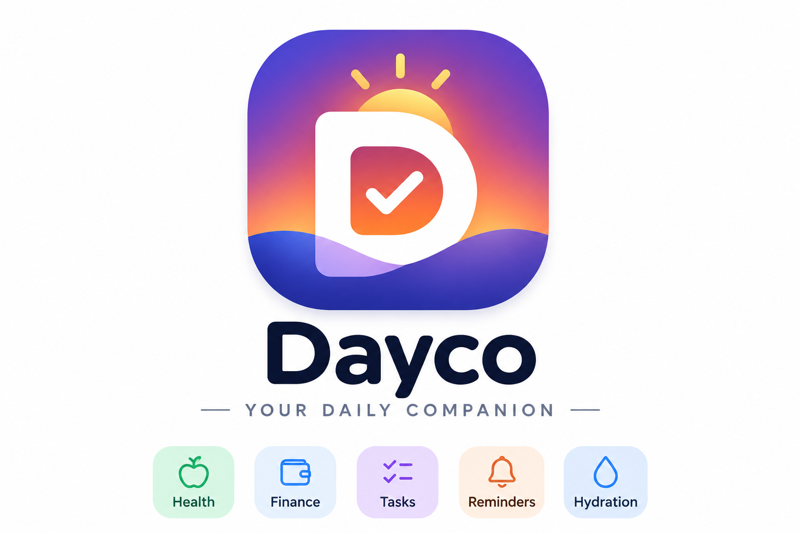

<p align="center"></p>

# Dayco: your daily companion

A personal Android app for planning your day and tracking what you eat.

- **Tasks:** add tasks with a date and time, set a reminder (at the time, or 5 to 60 minutes before), and repeat daily, on weekdays or weekly. A ring shows what percentage of the day's tasks are done, with a bar for each day of the week.
- **Alarms:** ring through Android's own alarm system, so they work when the app is closed, the screen is locked or the phone has restarted. A full-screen alarm offers **Mark as done**, **Snooze 5 min** and **Dismiss**. Sound, a spoken reminder ("Reminder. Call the bank. In 5 minutes.") and vibration can each be turned on or off in Settings.
- **Appearance:** pick System, Light or Dark in Settings. The alarm screen and system bars follow it too.
- **Calories:** set a daily goal and log food by meal. The page shows how much of the goal you've used, how much is left, and a week view.
- **Water:** a bottle fills up one 1-litre level at a time, with a moving water effect. Reminders ring at 9 AM, 12 PM and 6 PM (add up to 8 levels at your own times). Tap a level, or **Mark as done** on the alarm, to fill it. A pouring sound plays as it fills (switch it off in the Water tab).
- **Body:** set your starting and target weight, then log your weight daily or monthly. A human body outline changes shape with your progress, from a fuller start to a lean goal, with the goal shown as a dashed outline. It shows how much you've lost and how much is left, the change since your last weigh-in, your weekly rate, a timeline of body shapes, a weight chart, and an optional daily or monthly weigh-in reminder. Add your height to see your BMI on a colour scale (Asian/Indian or WHO ranges), the healthy weight range for your height, and the BMI of every weigh-in.
- **Money:** record expenses and income with an amount, category, note, date and payment method (UPI, cash, card, bank transfer). Each month shows what you spent, your income and balance, progress against an optional monthly budget, and where the money went by category.
- **Money effects:** saving income drops coins and notes into a piggy bank (which fills with gold to show how much money is left) with a cash register sound; saving an expense sends them flying out with a whoosh. The totals count to their new values. The sound can be switched off in Settings.
- **Export:** save a month or all-time money report as a **PDF** or an **Excel (.xlsx)** file. Both contain the transactions as a table, the totals, and a spending-by-category summary. You choose where on the phone to save it.

Turn features on or off in **Settings → Features**. Only the ones you turn on appear in the app. Turning one off also stops its reminders, and its data is kept for when you turn it back on.

## Install

1. Download [`apk/Dayco.apk`](apk/Dayco.apk) on your Android phone (Android 8.0 or newer) and open it. Allow "install unknown apps" when asked.
2. Open Dayco and allow notifications.
3. Go to **Settings → Phone permissions**. If anything is missing, tap **Fix**. On Xiaomi, Oppo, Vivo and Samsung phones, set Dayco's battery use to **Unrestricted** so alarms aren't blocked.
4. Tap **Test**, then lock the phone. The test alarm rings within 10 seconds.

Tasks and the food log are stored on the phone only.

## Project layout

| Path | What it is |
| --- | --- |
| `android/` | The Android app (Java, no extra libraries). |
| `android/app/src/main/assets/index.html` | The app's screens: tasks, calories, money and settings (HTML, CSS and JavaScript). |
| `apk/Dayco.apk` | A signed build, ready to install. |

How the Android side works:

- `MainActivity` shows the interface and gives the page a `DaycoNative` bridge. Every time tasks change, the page sends them over.
- `Scheduler` works out each task's next reminder time, including repeats, and books it with `AlarmManager.setAlarmClock`.
- `AlarmService` plays the alarm tone, reads the reminder aloud and vibrates. It also shows the alarm notification.
- `AlarmActivity` is the full-screen alarm page shown over the lock screen.
- `Exporter` writes the money report as a PDF (with Android's `PdfDocument`) or as an Excel workbook with a Transactions sheet and a Summary sheet.
- `BootReceiver` books the alarms again after a restart, an app update or a time-zone change.

## Build

You need JDK 17 or newer, Gradle 8.9 or newer, and the Android SDK with platform 35.

```bash
cd android
echo "sdk.dir=/path/to/android-sdk" > local.properties
gradle assembleRelease
```

The APK is written to `android/app/build/outputs/apk/release/`.

### Signing

The signing key is not in this repository. To sign builds, create `android/keystore.properties` (git ignores it):

```properties
storeFile=/path/to/daybell.keystore
storePassword=...
keyAlias=daybell
keyPassword=...
```

Without that file, `assembleRelease` produces an unsigned APK, which Android won't install. Use `gradle assembleDebug` for a test build instead. An update only installs over the existing app when it is signed with the same key as `apk/Dayco.apk`. Keep that key safe: without it you'd have to uninstall the app, which deletes its data.
